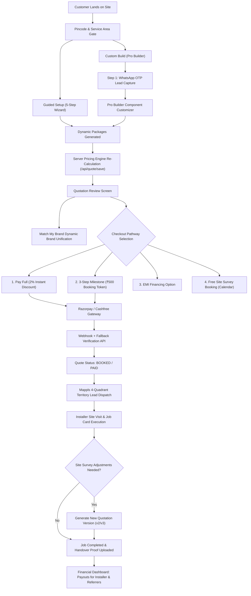

# Canonical Flow & System Wiring

## The Master Commercial & Operational Pipeline
The backbone of the TEAM CCTV Platform is an end-to-end state machine ensuring commercial integrity, mathematical parity, territory-accurate dispatch, and transparent multi-channel payouts.

---

### 1. Location Gate & Address Capture (Mappls Engine)
- **UI Trigger:** `ServiceAreaModal` / Homepage PINCODE input.
- **Provider:** Mappls (MapmyIndia) resolves Indian postal codes, district boundaries, and tehsils (with Google Maps / OSM fallback).
- **Map Pin-Drop:** Allows customer to pin-point exact installation location, auto-populating address fields.

### 2. Dual Funnel Requirement Capture & Early Lead Gate
- **Guided Setup (`/wizard`):** 5-step wizard capturing property type, indoor/outdoor camera counts, storage needs, and cabling status.
- **Custom Build (`/builder` - Pro Builder):**
  - **Early Lead Capture:** Customer Name and Mobile Number (WhatsApp OTP verified) are captured **at Step 1** before entering hardware selection, preventing lead leakage on technical configurations.
  - **Mobile Slide-Over Cart:** Responsive drawer (`showMobileCart`) enables complete BOM review on smartphones.
  - **Single-Option Filter Auto-Collapse:** Hides empty or single-option filters to eliminate visual clutter.

### 3. Server-Side Pricing Engine Execution (`/api/quote/save`)
- **Zero-Trust Client Pricing:** Client calculations are strictly discarded. All line items, margins, taxes, and labor rates are recomputed server-side in `lib/pricing-engine.ts`.
- **100% Mathematical Parity:** Guided Setup and Pro Builder configurations yield identical totals for identical Bills of Materials.
- **Component Rules:**
  - Competitive SMPS Selection: Lower price takes precedence even with higher channels.
  - Multi-PoE Gigabit Uplink Switch: Automatically attached when camera count exceeds single switch capacity.
  - Cable Bundling: Bundles (305m/100m) + per-meter balance evaluated against pure per-meter rates.
  - Connectors (`camera_count * 2` + 2 RJ45 for IP uplink) & Junction Boxes (`1:1`).
  - Labor: Zero margin markup. Full install (₹500 IP / ₹400 HD + 15m free cable pulling; excess ₹15/m); Fitting-only (₹200 HD / ₹300 IP + ₹500 visit charge).

### 4. Quote Review & "Match My Brand" Upsell
- **UI Element:** `InstantQuotationReview` (`/quote/[leadId]/review/[quoteId]`).
- **Brand Unification:** Defaults to "Mixed (Best Price)". Customer can click **"Match My Brand"** to dynamically unify all components under a single brand (e.g. CP Plus, Hikvision) if active stock exists.
- **Quotation Disclaimer:** Displays standard notice: *"Final quotation may differ based on actual site survey and requirements at installation time."*

### 5. Four Checkout Pathways & Payment Resilience
1. **Option 1: Pay Full Upfront:** Applies an instant 2% discount on total quote.
2. **Option 2: 3-Step Milestone Booking:** Charges a ₹500 advance token to lock installation slot.
3. **Option 3: EMI Financing:** Low-cost EMI financing plans prominently featured.
4. **Option 4: Free Site Survey Booking:** Embedded calendar date/time picker (restricted to future dates) for on-site consultation.
- **Payment Verification:** Razorpay/Cashfree webhook + client-side **Fallback Verification API** attached to payment success screen guarantees immediate status transition to `BOOKED` / `PAID`.

### 6. Geolocation Dispatch & 4-Quadrant Territory Routing
- **Territory Matching:** Matches customer address against the 4-Quadrant micro-zone (North-West, North-East, South-East, South-West) anchored by landmarks, operating radius, and polygon boundaries.
- **Visual Status:** Displays active technician coverage in blue circles, unassigned areas in red circles.
- **Installer Assignment:** Automatically dispatches lead to authorized local installer.

### 7. Installer Job Execution & Quotation Versioning
- **Job Card (`/installer/jobs/[id]`):** Details equipment BOM, site condition checklist, and required handover photos.
- **Site Prep Surcharges:** Installer can apply verified flags: ladder (₹500), marble (₹400), metal (₹200), furnished (₹300), heavy drilling (₹600) with ₹0 markup.
- **Quotation Versioning:** Any post-survey adjustment spawns a new version (`v2`, `v3`), preserving historical customer approval records.

### 8. Financial Dashboard & Payout Governance
- **Trigger:** Job marked `COMPLETED` with zero open punch-list items.
- **Payouts:** Admin approves payouts for:
  - Installers: Based on job completion and verified labor.
  - B2B Partners: 2% commission based on partner QR/referral code.
  - B2C Individual Referrers: ₹500 flat incentive per completed referral.
