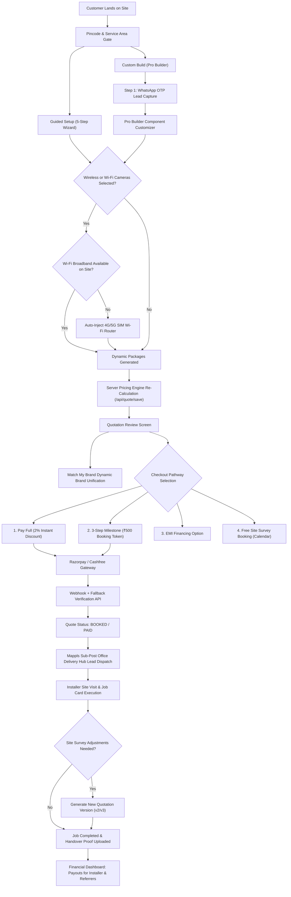

# Canonical Flow & System Wiring

## The Master Commercial & Operational Pipeline
The backbone of the TEAM CCTV Platform is an end-to-end state machine ensuring commercial integrity, mathematical parity, territory-accurate dispatch, and transparent multi-channel payouts.

---

### 1. Location Gate & Address Capture (Mappls Engine)
- **UI Trigger:** `ServiceAreaModal` / Homepage PINCODE input.
- **Provider:** Mappls (MapmyIndia) resolves Indian postal codes, district boundaries, and tehsils (with Google Maps / OSM fallback).
- **Map Pin-Drop:** Allows customer to pin-point exact installation location, auto-populating address fields.

### 2. Dual Funnel Requirement Capture & Early Lead Gate
- **Guided Setup (`/wizard`):** 5-step wizard capturing property type, indoor/outdoor camera counts, storage needs, and cabling status.
- **Custom Build (`/builder` - Pro Builder):**
  - **Early Lead Capture:** Customer Name and Mobile Number (WhatsApp OTP verified) are captured **at Step 1** before entering hardware selection, preventing lead leakage on technical configurations.
  - **Mobile Slide-Over Cart:** Responsive drawer (`showMobileCart`) enables complete BOM review on smartphones.
  - **Single-Option Filter Auto-Collapse:** Hides empty or single-option filters to eliminate visual clutter.

### 2.2 Omnichannel Site Work Urgency & Dynamic SLA Routing
- **Timeline Capture:** Across both Guided Setup (Step 4) and Pro Builder (Step 6), customers specify their preferred installation timeline:
  - `⚡ ASAP (1-2 Days)` ➔ `HOT` priority (15m SLA alert, 1-hour breach SLA).
  - `📅 Within a Week` ➔ `WARM` / `HOT` priority (60m SLA alert, 24-hour SLA).
  - `🗓️ This Month (Construction / Renovation)` ➔ `WARM` priority (24-hour SLA).
  - `🔍 Just Planning / Estimating Budget` ➔ `NURTURE` priority (3-day SLA).
- **Auto-Task Ingestion:** `app/actions/lead.ts` and `app/api/submissions/route.ts` automatically calculate `sla_breach_at` and enqueue an initial task into `followup_tasks` collection for inside sales routing.
- **Interactive WhatsApp Bot Integration:** Question 9 of 9 in WhatsApp conversational flow prompts customer with interactive 3-button urgency menu (`⚡ ASAP`, `📅 Within a Week`, `🗓️ This Month / Later`) and eagerly tags lead in Firestore.
- **Admin Workspace Surfacing:** Badges visible on `/admin/leads` table (with 1-click WhatsApp chat launch), Kanban pipeline cards, Lead 360 overview header, and slide-over lead drawer.

### 2.1 Wi-Fi Connectivity Check & Standalone Router Injection (Option B)
- **Wi-Fi Readiness Check:** When choosing Wireless technology or adding supplemental Wi-Fi cameras in a wired setup, the wizard asks: *"Do you have a working Wi-Fi connection at the installation site?"*
- **Automatic 4G/5G Router Injection:** If **No**, the engine injects a 4G/5G SIM Wi-Fi router into the quotation BOM. If **Yes**, no router is added.
- **MicroSD Card Multiplication & Safety Caps:** Pure wireless quotes allocate 1 MicroSD card per camera (`qty = camera_count`). Hybrid quotes allocate 1 MicroSD card per Wi-Fi camera. Sized via H.265 baseline bitrates (0.40 smart motion multiplier) and capped strictly by `camera.max_sd_capacity_gb || 128`.

### 3. Server-Side Pricing Engine Execution (`/api/quote/save`)
- **Zero-Trust Client Pricing:** Client calculations are strictly discarded. All line items, margins, taxes, and labor rates are recomputed server-side in `lib/pricing-engine.ts`.
- **100% Mathematical Parity:** Guided Setup and Pro Builder configurations yield identical totals for identical Bills of Materials.
- **Component Rules:**
  - Recorder (DVR/NVR) Resolution Sizing & Cost Optimization: $\text{recMaxMP} \ge \max(\text{Camera MP})$. If a 5MP recorder is cheaper than a 2MP recorder, the system picks the cheaper 5MP recorder. 2MP recorders are strictly disqualified for 4MP, 5MP, and 8MP cameras. Mixed setups size to the highest resolution camera.
  - Competitive SMPS Selection: Lower price takes precedence even with higher channels.
  - Multi-PoE Gigabit Uplink Switch: Automatically attached when camera count exceeds single switch capacity.
  - Cable Bundling: Bundles (305m/100m) + per-meter balance evaluated against pure per-meter rates.
  - Connectors (`camera_count * 2` + 2 RJ45 for IP uplink) & Junction Boxes (`1:1`).
  - Labor: Zero margin markup. Full install (₹500 IP / ₹400 HD + 15m free cable pulling; excess ₹15/m); Fitting-only (₹200 HD / ₹300 IP + ₹500 visit charge); Wireless Pro Fitting (₹349/camera vs ₹0 DIY delivery).

### 4. Quote Review & "Match My Brand" Upsell
- **UI Element:** `InstantQuotationReview` (`/quote/[leadId]/review/[quoteId]`).
- **Brand Unification:** Defaults to "Mixed (Best Price)". Customer can click **"Match My Brand"** to dynamically unify all components under a single brand (e.g. CP Plus, Hikvision) if active stock exists.
- **Quotation Disclaimer:** Displays standard notice: *"Final quotation may differ based on actual site survey and requirements at installation time."*

### 4.1 Competitor Price Match Guarantee & Admin Deal Desk
- **On-Card Anchoring:** Every package card features `"Lower competitor quote? Match Price"` (`PriceMatchModal.tsx`), passing `selected_package_title` and `selected_package_price`. Floating unanchored popups are permanently eliminated.
- **Self-Healing Baseline Quotation Engine (`lib/baseline-quote.ts`):** If a customer initiates a price match or views their quote without saving a selected card, `getOrCreateLeadQuote(leadOrQuoteId)` generates an authoritative 8-item quote from `wizard_answers` on demand, guaranteeing zero ₹0 quotes and 100% reliable PDF streaming (`/api/quote/[quoteId]/download`).
- **Admin Deal Desk (`/admin/leads/[leadId]`):** Admin reviews competitor quotes side-by-side against our catalog price, applies counter strategies (Match Exact, Beat by ₹500, Custom), and generates 1-click WhatsApp counter-offers emphasizing 100% Solid Pure Copper Cable and Genuine Surveillance Storage (strictly zero prohibited warranty claims).

### 5. Four Checkout Pathways & Payment Resilience
1. **Option 1: Pay Full Upfront (Smart Pay):**
   - Applies an instant 2% discount on the total quote.
   - Generates an official **TAX INVOICE** (not Advance Receipt) with **PAID** watermark, `amountDue: 0`, and an itemized line: `Smart Pay Discount (2%): -₹...`.
   - Sets lead/quote status directly to `PAID` / `ORDER CONFIRMED (FULLY PAID)`.
2. **Option 2: 3-Step Milestone Booking:** Charges a ₹500 advance token to lock installation slot (generates Advance Receipt; 90% balance due on material delivery, 10% on installation completion).
3. **Option 3: EMI Financing:** Low-cost EMI financing plans prominently featured.
4. **Option 4: Free Site Survey Booking:** Embedded calendar date/time picker (restricted to future dates) for on-site consultation.
- **Payment Verification:** Razorpay/Cashfree webhook + client-side **Fallback Verification API** attached to payment success screen guarantees immediate status transition to `BOOKED` / `PAID`.

---

### 5.1 Material Delivery Handover & 90% Collection (`/delivery/[quoteId]`)
- **Zero Due for Smart Pay:** If the customer paid in full upfront with Smart Pay discount, the delivery screen automatically detects `amountDue = 0` and displays a `✓ Smart Pay (Fully Paid)` badge. The delivery agent only collects the 4-digit customer delivery OTP.
- **On-Screen Dynamic UPI QR:** For milestone quotes with balance due, the delivery agent renders an instant dynamic Razorpay/UPI QR directly on their mobile screen (`DynamicOnScreenQRCodeModal`). The customer scans with Google Pay, PhonePe, or Paytm; payment confirms in 2-3 seconds with an audio chime, and the receipt is auto-dispatched to WhatsApp.
- **Strict Admin-Gated Cash Collection:** The physical cash collection checkbox is strictly disabled and locked unless an Admin has approved cash collection for that job (`cash_collection_approved: true`). Delivery agents can submit a 1-click cash approval request to the Admin desk.

---

### 5.2 Dual-Entity Field Beat Planning & B2B Partner Engagement
- **Unified Day Routes:** Salespersons execute daily route plans combining Customer Site Surveys (Leads) and B2B Channel Partner courtesy visits (Promoters).
- **Inactivity Aging Engine (`lib/inactivity-tracker.ts`):** Monitors `last_visited_at`, `last_called_at`, and `last_whatsapp_at`. Automatically calculates days inactive and flags accounts into 4 tiers: `🟢 Active (<7d)`, `🟡 Due Soon (7-14d)`, `🔴 Overdue (>14d)`, and `⚠️ Never Visited`.
- **Zero-Paperwork Touchpoint Logging (`/api/crm/touchpoint`):** Clicking WhatsApp or Call action buttons automatically timestamps the interaction and resets the inactivity timer. On-site visit check-in captures meeting notes and GPS location.
- **Route Optimization (VRPTW):** Partitions stops into Morning (09:30-13:00), Afternoon (13:30-17:00), and Evening (17:30-20:00), calculates Haversine distances, minimizes total driving kilometers, and generates 1-click turn-by-turn navigation in Google Maps.

### 6. Geolocation Dispatch & Sub-Post Office Delivery Micro-Hub Routing
- **Territory Matching:** Matches customer address tokens against authentic Sub-Post Office Delivery Micro-Hubs (with local communicating names), operating radius, and cadastral polygon boundaries.
- **Visual Status:** Displays active technician coverage with green pill shortcodes (`[✓ NR]`, `[✓ LC]`) and 850m halos, unassigned areas in red dashed halos.
- **Installer Assignment:** Automatically dispatches lead to authorized local installer.

### 7. Installer Job Execution, On-Site Change Orders & Field Handover
- **Job Card (`/installer/jobs/[id]`):** Details equipment BOM, site condition checklist, and required handover photos.
- **Site Prep Surcharges:** Installer can apply verified flags: ladder (₹500), marble (₹400), metal (₹200), furnished (₹300), heavy drilling (₹600) with ₹0 markup.
- **On-Site Extra Materials & Change Orders (GST Section 15 & 34 Invariant):**
  - If additional materials (Cat6 cabling, conduit, junction boxes, wall brackets) or labor are required on-site, the installer uses `+ Add Site Extra / Change Order` (`InstallerChangeOrderModal`).
  - The finalized base Tax Invoice is preserved intact to maintain GST compliance.
  - The system creates a **Supplementary Change Order (`CO-xxxx`)** and issues an official **Supplementary Tax Invoice (`INV-xxxx-S1`)** with deterministic 18% GST.
- **On-Screen Dynamic UPI QR Collection:**
  - The installer renders an on-screen dynamic UPI QR code on their smartphone screen (`DynamicOnScreenQRCodeModal`).
  - Customer scans using GPay, PhonePe, or Paytm; verifies in 2-3s with audio confirmation; Tax Invoice receipt auto-delivered to WhatsApp.
- **Admin-Gated Cash Collection:**
  - "Pay Cash to Installer" is strictly disabled unless an Admin or admin staff approves cash collection for that job (`cash_collection_approved: true`).
  - Installers can send a 1-click cash approval request to the Admin desk (`/api/installer/cash-approval/request`).
- **Quotation Versioning:** Pre-installation survey adjustments spawn new quotation versions (`v2`, `v3`), preserving historical customer approval records.

### 8. Financial Dashboard & Payout Governance
- **Trigger:** Job marked `COMPLETED` with zero open punch-list items.
- **Payouts:** Admin approves payouts for:
  - Installers: Based on job completion and verified labor.
  - B2B Partners: 2% commission based on partner QR/referral code.
  - B2C Individual Referrers: ₹500 flat incentive per completed referral.

### 9. WhatsApp Conversational Quotation Pipeline & Resilience Architecture
- **Step 1: First-Touch Language Gate:**
  - Welcomes customer with a bilingual English/Hindi greeting.
  - Numbered selection menu (1 to 11) supporting English, Hindi, Marathi, Gujarati, Tamil, Telugu, Kannada, Bengali, Malayalam, Punjabi, and Odia.
  - Customer continues the entire journey in their preferred language with everyday layman terms.
- **Step 2: Property Type & Pincode Verification:**
  - Captures property type (Home/Flat, Shop/Office, Factory/Plot).
  - Validates 6-digit postal pincode against serviceability directory.
  - Intercepts 10-digit mobile numbers accidentally typed at the pincode prompt.
- **Step 3: Camera Architecture Selection:**
  - Wired Standard HD, Wired Digital IP, or Smart Wireless.
- **Step 4: Camera Counts with Hybrid Input:**
  - Direct numeric reply: Customer can type any single number (e.g. `4` or `8`) or tap interactive buttons (`[ 2 ]`, `[ 4 ]`, `[ 8 ]`).
  - Supports separate Outdoor Weatherproof Bullet and Indoor Dome counts.
- **Step 5: Camera Configuration Summary (Option A):**
  - Confirms counts using strictly 2 Meta API compliant buttons:
    - `[ ✅ Done (Proceed) ]` (`wf_done_proceed`)
    - `[ ✏️ Change Qty ]` (`wf_change_qty`)
- **Step 6: Non-Destructive Quantity Modifier (`ASK_CAMERA_EDIT_CHOICE`):**
  - Tapping `[ ✏️ Change Qty ]` allows modifying camera counts without wiping customer session data.
- **Step 7: Real-Time Omnichannel BOM & Pricing Parity:**
  - Quotation engine generates real-time hardware Bill of Materials (BOM) strictly matching web calculation rules.
  - 18% GST inclusive standard with full mathematical reconciliation.
  - Interactive PDF download and direct web link sent via WhatsApp.
- **Resilience Engine:**
  - Any sent images, videos, audio notes, or off-topic questions are handled gracefully without breaking state.
  - Name protection filter shields customer lead records from price queries.
  - Canonical phone formatting standardizes leads to `91XXXXXXXXXX`.
- **OTP Gate, Error Sanitization & Cross-Device App Launcher (Website Flows):**
  - Customer OTP delivery (`/api/auth/otp/whatsapp`, `/api/auth/otp/sms`, `/api/refer-and-earn/otp/send`) routes through `Msg91WhatsAppProvider.sendOtpTemplate()` (`lib/whatsapp/msg91-provider.ts`) with CRLF-stripped credentials (`lib/env-utils.ts`).
  - Client UI components extract structured API/exception errors via `extractErrorMessage()` (`lib/utils.ts`) to prevent `[object Object]` toasts on every journey screen.
  - `WhatsAppOtpNotice` (`components/shared/WhatsAppOtpNotice.tsx`) and `lib/whatsapp.ts` invoke the native WhatsApp app synchronously via `<a href="whatsapp://send?phone=...">` with adaptive `wa.me` (mobile) / `web.whatsapp.com` (desktop) fallback after `1600ms`.
